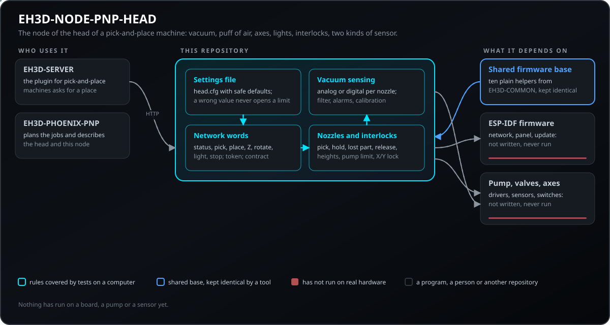

<p align="center">
  
</p>

# 🛠️ EH3D-NODE-PNP-HEAD

<p align="center"><a href="README.md">🇺🇸 English</a> | <a href="README_spa.md">🇪🇸 Español</a> | <a href="README_fra.md">🇫🇷 Français</a> | <a href="README_ita.md">🇮🇹 Italiano</a> | 🇩🇪 <b>Deutsch</b> | <a href="README_zho.md">🇨🇳 中文</a> | <a href="README_jpn.md">🇯🇵 日本語</a> | <a href="README_por.md">🇵🇹 Português</a></p>

### Der Knoten des Bestückkopfs einer EH3D-Bestückungsmaschine: Düsen, Vakuum, Blasstoß, Licht und Verriegelungen, geschrieben und gegen einen Simulator erprobt

<p align="center">
  
  
  
  
  
  
</p>

---

**Ehrlichkeitscheck - was heute tatsächlich läuft:** ein Gerüst mit echter, getesteter Logik und ohne Hardware. Die Regeln des Knotens laufen auf einem Rechner gegen einen Simulator (85 Tests bestehen), aber nichts davon wurde als Firmware gebaut, geflasht oder mit einer Pumpe, einem Ventil, einem Drucksensor oder einer Achse verbunden.

---

> **Stand von Sicherheit und IT-Sicherheit:** dieser Knoten ist kein Sicherheitssystem. Seine Verriegelungen und sein sicherer Zustand sind eine zweite Linie hinter Stopp, Grenzen und Verriegelungen der Maschine und ihrer Steuerung und ersetzen diese nie.

## 📋 Auf einen Blick

| | |
|---|---|
| Version | `0.0.2` |
| Reifegrad | Funktionsfähig |
| Tests | 85 |
| Technologie-Stack | C++17 (host tests), Python 3.10+ |
| Auf echter Hardware | Noch nicht auf Hardware ausgeführt |

**Springe zu:** [Überblick](#-überblick) · [Architektur](#-architektur) · [Schnellstart](#-schnellstart) · [Tests](#-tests) · [Struktur des Repositorys](#-struktur-des-repositorys) · [Verwandte Projekte](#-verwandte-projekte)

## 🚦 Projektstatus

Jede Zeile ist ein Teil dieses Repositorys, und die Ampel sagt, wie weit er heute ist. Sie beruht auf dem, was das Repository zeigen kann (Tests, Builds, Läufe), nicht auf dem, was geplant ist.

🟢 Fertig und überprüft · 🟡 Funktioniert, mit bekannten Grenzen · 🟠 Teilweise fertig oder noch nicht überprüft · 🔴 Nicht gemacht oder funktioniert nicht

| Bereich | Stand | Was das hier bedeutet |
|---|---|---|
| Logik und Simulator | 🟡 | Die Regeln des Knotens laufen gegen einen Simulator mit festem Seed; 85 Tests bestehen auf einem Rechner. |
| Netzwerkvertrag | 🟡 | Die Worte des Knotens stehen in docs/CONTRACT.md und ein Test schlägt fehl, wenn Seite und Antworten abweichen; das Plugin des Servers nutzt diesen Knoten noch nicht. |
| Firmware | 🟠 | Die Firmware für die Platine ist noch nicht geschrieben: nur die einfachen Helfer der gemeinsamen Basis sind importiert. |
| Echte Hardware | 🔴 | Auf einer Pumpe, einem Ventil, einem Drucksensor oder einer Achse ist noch nichts gelaufen. |

## 🎯 Überblick

* **Ein Knoten, ein Kopf:** er nimmt Teile mit dem Vakuum jeder Düse auf und setzt sie ab, unterscheidet ein verlorenes Teil von einem nie vorhandenen, bewegt die Z-Achse und die Drehung unter Verriegelungen und geht von selbst in einen sicheren Zustand, wenn er den Server verliert.
* **Zwei Arten, das Vakuum zu erfassen, und eine Sperre für die Achsen:** jede Düse hat einen Drucksensor (gefiltert, kalibriert, mit Band) oder einen Vakuumschalter (entprellt), gewählt in `head.cfg`, mit Alarmen für verlorenes Teil, nicht erreichtes Vakuum und Sensor außerhalb des Bereichs oder eingefroren; der Kopf meldet außerdem, wann alle Düsen auf die sichere Höhe angehoben sind, damit die Maschine in X und Y fahren darf, und verweigert in der Zeit das Absenken einer Düse.

## 🧩 Rolle in EH3D

Das Programm für Pick and Place plant die Aufträge; dieser Knoten führt künftig das Aufnehmen und Absetzen an einer Düse aus, sobald eine echte Maschine angeschlossen ist. Heute existiert er nur als Logik und Simulator.

## 🏛️ Architektur

<p align="center">
  
</p>

Wie die Teile dieses Repositorys zusammenpassen: wer es nutzt, was es enthält und wovon es abhängt. Das Bild wird aus `docs/architecture.json` gezeichnet und gegen den Code geprüft.

## 🔒 Sicherheit und Schutz

Die Sicherheitsregeln dieses Knotens; der Test, der jede zeigt, ist in docs/REQUIREMENTS.md genannt:

* Ein Knoten ohne Token weist jede Anfrage ab, die etwas bewegt oder ändert; das Token wird nie angezeigt, zurückgeschrieben oder protokolliert.
* Hört der Knoten den Server nicht, geht er von selbst in einen sicheren Zustand und bewegt nichts, bis eine Person quittiert.
* Jede Grenze ist eine Einstellung mit vorsichtigem Standardwert, und ein falscher Wert lockert nie eine: er wird abgewiesen und der Standardwert bleibt.

## 🔌 Schnittstellen

Server, Programme und Telefone sprechen mit dem Knoten über HTTP wie die anderen Knoten der Suite (JSON und ein Bearer-Token). Die Seite [docs/CONTRACT.md](docs/CONTRACT.md) ist der Vertrag und ein Test hält sie mit den Antworten gleich.

```text
GET  /api/status                         the head and all its nozzles (always answered)
GET  /api/nozzle?n=N                     one nozzle
POST /api/nozzle/pick?n=N                open the valve; answer when the vacuum says if a part is held
POST /api/nozzle/place?n=N               release the part with a puff (only low enough)
POST /api/nozzle/blow?n=N                a puff alone (not while a part is held)
POST /api/z?n=N&mm=H                     move the nozzle to the height H
POST /api/rotate?n=N&deg=D               turn the nozzle (only high enough)
POST /api/light?up=P&down=Q              the two lights, in percent
POST /api/stop                           stop every move (the vacuum is not touched)
POST /api/ack[?n=N]                      clear a fault that is gone (or the safe state, without n)
POST /api/vacuum/calibrate?n=N&kind=zero|scale[&kpa=K]   if the settings allow it
POST /api/xy?moving=1|0                    the machine asks to move in X and Y (only with every nozzle raised) or says it stopped
```

## ⚙️ Konfiguration

Jeder abgestimmte Wert steht in `head.cfg`; `head.cfg.example` zeigt alle mit Standardwerten und Bereichen. Ein Wert außerhalb des Bereichs oder ein unbekannter Schlüssel wird gemeldet und der Standardwert bleibt.

## 🚀 Schnellstart

Sie brauchen einen C++17-Compiler, CMake 3.16 oder neuer und Python 3.10 oder neuer; sonst ist nichts zu installieren.

```bash
cmake -S tests -B build/host
cmake --build build/host
ctest --test-dir build/host --output-on-failure
python -I tools/ci_validate.py
python -I -m unittest discover -s tools -p "test_*.py"
```

## 🧪 Tests

85 Tests: C++-Tests auf dem Rechner mit festem Seed (sie lassen den Simulator und die Netzwerkworte laufen und vergleichen die Vertragsseite mit den Antworten) und Python-Tests des Repositorys. Die CI führt die C++-Tests auch mit AddressSanitizer und UBSan aus.

## 🏗️ Build und Veröffentlichung

Die Version steht in `eh3d.project.json` und jede Version hat ihren Eintrag in [CHANGELOG.md](CHANGELOG.md). Einen Firmware-Build gibt es noch nicht; sobald es Firmware gibt, wird sie nur in GitHub Actions gebaut. Die Software ist GPL-3.0-or-later; die mechanischen Teile des Knotens sollen unter CC-BY-SA und seine Elektronik unter CERN-OHL-S veröffentlicht werden (siehe [docs/HARDWARE.md](docs/HARDWARE.md)).

## 📂 Struktur des Repositorys

<p align="center">
  
</p>

<details>
<summary>Textversion des Baums</summary>

```text
EH3D-NODE-PNP-HEAD/
├── core/
│   ├── head_config.hpp cfg_text.hpp                                                                                                         die Einstellungsdatei und ihre sicheren Standardwerte
│   ├── head.hpp                                                                                                                             Düsen, Pumpe und Achsen; analoges oder digitales Vakuum; die X/Y-Sperre
│   ├── head_node.hpp version.hpp                                                                                                            die Worte des Knotens im Netzwerk
│   ├── head_sim.hpp                                                                                                                         ein Kopf am Rechner: Pumpe, Ventile, Teile, Drucksensoren und Schalter
│   └── json.hpp auth.hpp semver.hpp backoff.hpp task_health.hpp stored_load.hpp memory_budget.hpp net_text.hpp node_id.hpp civil_time.hpp   einfache Helfer, die alle Knoten teilen und ein Werkzeug gleich hält
├── tests/
│   ├── check.hpp CMakeLists.txt                                                                                                             der Rahmen der Tests und wie sie gebaut werden
│   ├── test_config.cpp                                                                                                                      die Einstellungsdatei, der Filter und die Kalibrierung
│   ├── test_head.cpp                                                                                                                        der Kopf an simulierter Pumpe und Sensoren: Aufnahmen, Verluste, Verriegelungen, sicherer Zustand
│   ├── test_sensor.cpp                                                                                                                      analoge und digitale Vakuumerfassung, Alarme und die X/Y-Sperre
│   └── test_node.cpp                                                                                                                        die Netzwerkworte, das Token, der sichere Zustand und die Vertragsseite
├── docs/
│   ├── CONTRACT.md                                                                                                                          was der Knoten im Netzwerk (und in der Kette) sagt
│   ├── REQUIREMENTS.md                                                                                                                      jede Anforderung und der Test, der sie zeigt
│   ├── SCOPE.md STATUS.md NOT_YET.md                                                                                                        wofür es da ist, wie weit es ist, was wartet
│   ├── HARDWARE.md                                                                                                                          vorläufige Teile, Prüfstandtests und Lizenzen
│   └── architecture.json structure.json                                                                                                     die Daten der beiden Bilder
├── tools/                                                                                                                                   die Repository-Prüfung, ihre Tests und die Bild-Werkzeuge
├── images/                                                                                                                                  Banner und die Bilder von Architektur und Repository-Struktur
├── .github/                                                                                                                                 CI- und Dashboard-Workflows, Vorlagen für Issues und Pull Requests
├── eh3d.project.json                                                                                                                        Manifest: Version, Rolle, Reifegrad und Build-Befehl
├── head.cfg.example                                                                                                                         alle Einstellungen mit Standardwerten und Bereichen
├── VERSION                                                                                                                                  die Version des Repositorys
├── CHANGELOG.md                                                                                                                             was sich in jeder Version geändert hat
├── AGENTS.md                                                                                                                                Regeln für alle, die das Repository ändern
├── test.sh test.bat                                                                                                                         die Rechnertests ausführen
├── SECURITY.md SUPPORT.md                                                                                                                   Schwachstellen melden und Fragen stellen
└── CONTRIBUTING.md CODE_OF_CONDUCT.md LICENSE                                                                                               Mitwirken, Verhaltenskodex und Lizenz
```

</details>

## 🗺️ Roadmap und bekannte Grenzen

**Bekannte Grenzen heute**

* Es sind weder Firmware noch Pumpen- oder Ventilausgang, Druckmessung oder Achstreiber geschrieben; das simulierte Vakuum und das Rauschen sind erfunden. Wie die Steuerung der Maschine erfährt, dass die Düsen angehoben sind, ist nicht entschieden.

**Als Nächstes**

* Die ESP-IDF-Firmware auf der gemeinsamen Basis, die Ausgänge für Pumpe und Ventile und das Lesen der Drucksensoren, danach ein erster Test einer Düse auf dem Prüfstand.

## 🌍 Sprachen

README und Texte gibt es auf Englisch, Spanisch, Französisch, Italienisch, Deutsch, Chinesisch, Japanisch und europäischem Portugiesisch.

## 🔗 Verwandte Projekte

* [EH3D-PHOENIX-PNP](https://github.com/JuanenRac/EH3D-PHOENIX-PNP): das Pick-and-Place-Programm, das die Aufträge plant und diesen Knoten beschreibt
* [EH3D-SERVER](https://github.com/JuanenRac/EH3D-SERVER): der Server, dessen Plugin für Pick-and-Place-Maschinen hinter diesem Knoten stehen wird
* [EH3D-COMMON](https://github.com/JuanenRac/EH3D-COMMON): die Firmware-Basis, aus der dieser Knoten seine einfachen Helfer nimmt
* [EH3D-NODE-PNP-FEEDER](https://github.com/JuanenRac/EH3D-NODE-PNP-FEEDER): der Knoten der Zuführer, die die Teile bringen

## 📚 Dokumentation

* [Die Konventionen der Suite](https://github.com/JuanenRac/EH3D-DOCS/blob/main/docs/CONVENTIONS.md)
* [Der Vertrag des Knotens](docs/CONTRACT.md)
* [Anforderungen und der Test zu jeder](docs/REQUIREMENTS.md)
* [Umfang](docs/SCOPE.md), [Stand](docs/STATUS.md) und [was noch nicht gemacht ist](docs/NOT_YET.md)
* [Hardware: vorläufige Teile, Prüfstandtests und Lizenzen](docs/HARDWARE.md)
* [Änderungsprotokoll](CHANGELOG.md)

## 🤝 Mitwirken und Community

* Führe vor einem Pull Request `python -I tools/ci_validate.py` und die Tests der Basis aus: alles muss bestehen. Siehe [CONTRIBUTING.md](CONTRIBUTING.md) und den [Verhaltenskodex](CODE_OF_CONDUCT.md).
* Das README gibt es in acht Sprachen: Eine Textänderung wird in allen acht Dateien gemacht, und die beiden Bilder werden aus `docs/architecture.json` und `docs/structure.json` mit `tools/make_architecture.py` und `tools/make_structure.py` gezeichnet.
* Melde eine Schwachstelle privat: [SECURITY.md](SECURITY.md). Fragen, Ideen und Meldungen: electrohobby3d@gmail.com ([SUPPORT.md](SUPPORT.md)).

## 👤 AUTOR

**JuanenRac (Electro Hobby 3D)** · electrohobby3d@gmail.com

## 📜 LIZENZ

Software: GPL-3.0-or-later. Siehe [LICENSE](LICENSE). Hardware: die mechanischen Teile sind für CC-BY-SA vorgesehen, die Elektronik für CERN-OHL-S (siehe [docs/HARDWARE.md](docs/HARDWARE.md)).
