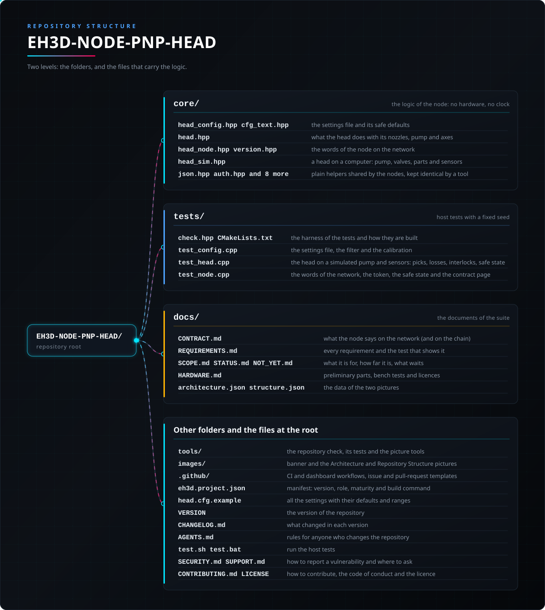

<p align="center">
  
</p>

# 🛠️ EH3D-NODE-PNP-HEAD

<p align="center"><a href="README.md">🇺🇸 English</a> | 🇪🇸 <b>Español</b> | <a href="README_fra.md">🇫🇷 Français</a> | <a href="README_ita.md">🇮🇹 Italiano</a> | <a href="README_deu.md">🇩🇪 Deutsch</a> | <a href="README_zho.md">🇨🇳 中文</a> | <a href="README_jpn.md">🇯🇵 日本語</a> | <a href="README_por.md">🇵🇹 Português</a></p>

### El nodo del cabezal de una máquina pick and place de EH3D: boquillas, vacío, soplido, luces y bloqueos, escrito y probado contra un simulador

<p align="center">
  
  
  
  
  
  
</p>

---

**Comprobación de honestidad - lo que se ejecuta hoy:** un nodo que funciona en simulación: lógica real y probada, sin firmware y sin hardware. Las reglas del nodo se ejecutan en un ordenador contra un simulador (pasan 103 pruebas), pero nada de esto se ha compilado como firmware, flasheado ni conectado a una bomba, una válvula, un sensor de presión o un eje.

---

> **Estado de seguridad (safety) y de seguridad informática:** este nodo no es un sistema de seguridad. Sus bloqueos y su estado seguro son una segunda línea detrás de la parada, los límites y los bloqueos de la máquina y de su controlador, y nunca los sustituyen.

## 📋 De un vistazo

| | |
|---|---|
| Versión | `0.0.3` |
| Madurez | Funcional |
| Pruebas | 103 |
| Pila tecnológica | C++17 (host tests), Python 3.10+ |
| En hardware real | Aún no se ha ejecutado en hardware |

**Ir a:** [Resumen](#-resumen) · [Arquitectura](#-arquitectura) · [Inicio rápido](#-inicio-rápido) · [Pruebas](#-pruebas) · [Estructura del repositorio](#-estructura-del-repositorio) · [Proyectos relacionados](#-proyectos-relacionados)

## 🚦 Estado del proyecto

Cada línea es una parte de este repositorio y la luz dice hasta dónde llega hoy. Se escribe con lo que el repositorio puede demostrar (pruebas, compilaciones, ejecuciones), no con lo previsto.

🟢 Hecho y verificado · 🟡 Funciona, con límites conocidos · 🟠 Hecho a medias o sin verificar · 🔴 Sin hacer o sin funcionar

| Área | Estado | Qué significa aquí |
|---|---|---|
| Lógica y simulador | 🟡 | Las reglas del nodo se ejecutan contra un simulador con semilla fija; pasan 103 pruebas en un ordenador. |
| Contrato de red | 🟡 | Las palabras del nodo están en docs/CONTRACT.md y una prueba falla si la página y las respuestas difieren; el plugin del servidor todavía no usa este nodo. |
| Firmware | 🟠 | El firmware de la placa aún no está escrito: solo se han importado los ayudantes simples de la base compartida. |
| Hardware real | 🔴 | Nada se ha ejecutado en una bomba, una válvula, un sensor de presión o un eje. |

## 🎯 Resumen

* **Un nodo, un cabezal:** recoge y suelta piezas con el vacío de cada boquilla, distingue una pieza perdida de una que nunca estuvo, mueve el eje Z y la rotación con bloqueos y pasa solo a un estado seguro si pierde el servidor.
* **Dos modos de medir el vacío y un bloqueo de los ejes:** cada boquilla tiene un sensor de presión (filtrado, calibrado, con banda) o un presostato (con antirrebote), a elegir en `head.cfg`, con alarmas de pieza perdida, vacío no alcanzado y sensor fuera de rango o congelado; el cabezal también dice cuándo todas las boquillas están levantadas a la altura segura, para que la máquina pueda moverse en X e Y, y se niega a bajar una boquilla mientras tanto.

## 🧩 Papel en EH3D

El programa de pick and place planifica los trabajos; este nodo será el que ejecute una recogida y una suelta en una boquilla cuando se conecte una máquina real. Hoy solo existe como lógica y simulador.

## 🏛️ Arquitectura

<p align="center">
  
</p>

Cómo encajan las partes de este repositorio: quién lo usa, qué contiene y de qué depende. La imagen se dibuja desde `docs/architecture.json` y se comprueba contra el código.

## 🔒 Seguridad y protección

Las reglas de seguridad y de protección de este nodo; la prueba que muestra cada una está nombrada en docs/REQUIREMENTS.md:

* Un nodo sin token rechaza toda petición que mueva o cambie algo; el token nunca se muestra, se reescribe ni se registra.
* Si no se oye al servidor, el nodo pasa solo a un estado seguro y no mueve nada hasta que una persona lo reconoce. Mientras una orden espera (un movimiento largo, una recogida larga) el nodo sigue escuchando: el servidor tiene que seguir preguntando, y un enlace perdido a mitad detiene el movimiento. El nodo dice cuánto es ese tiempo sin que se lo pregunten: `link_lost_ms` en `GET /api/status`, el valor de sus ajustes.
* Cada límite es un ajuste con un valor por defecto prudente, y un valor erróneo nunca afloja uno: se rechaza y queda el valor por defecto.

## 🔌 Interfaces

El servidor, los programas y los móviles hablan con el nodo por HTTP al modo de los demás nodos de la suite (JSON y un token bearer). La página [docs/CONTRACT.md](docs/CONTRACT.md) es el contrato y una prueba la mantiene igual que las respuestas.

```text
GET  /api/status                         the head and all its nozzles (always answered)
GET  /api/nozzle?n=N                     one nozzle
POST /api/nozzle/pick?n=N                open the valve; answer when the vacuum says if a part is held
POST /api/nozzle/place?n=N               release the part with a puff (only low enough)
POST /api/nozzle/blow?n=N                a puff alone (not while a part is held)
POST /api/z?n=N&mm=H                     move the nozzle to the height H
POST /api/rotate?n=N&deg=D               turn the nozzle (only high enough)
POST /api/light?up=P&down=Q              the two lights, in percent
POST /api/stop                           stop every move (the vacuum is not touched)
POST /api/ack[?n=N]                      clear a fault that is gone (or the safe state, without n)
POST /api/vacuum/calibrate?n=N&kind=zero|scale[&kpa=K]   if the settings allow it
POST /api/xy?moving=1|0                    the machine asks to move in X and Y (only with every nozzle raised) or says it stopped
```

## ⚙️ Configuración

Cada valor afinado está en `head.cfg`; `head.cfg.example` los muestra todos con sus valores por defecto y rangos. Un valor fuera de rango, o una clave que nadie conoce, se avisa y queda el valor por defecto.

## 🚀 Inicio rápido

Necesita un compilador de C++17, CMake 3.16 o más reciente y Python 3.10 o más reciente; no hay nada más que instalar.

```bash
cmake -S tests -B build/host
cmake --build build/host
ctest --test-dir build/host --output-on-failure
python -I tools/ci_validate.py
python -I -m unittest discover -s tools -p "test_*.py"
```

## 🧪 Pruebas

103 pruebas: pruebas de C++ en el ordenador con semilla fija (ejecutan el simulador y las palabras de la red y comparan la página del contrato con las respuestas) y pruebas de Python del repositorio. La CI también ejecuta las de C++ con AddressSanitizer y UBSan.

## 🏗️ Compilación y publicación

La versión vive en `eh3d.project.json` y cada versión tiene su entrada en [CHANGELOG.md](CHANGELOG.md). Aún no hay compilación de firmware; cuando exista se compilará solo en GitHub Actions. El software es GPL-3.0-or-later; las piezas mecánicas del nodo se publicarán con CC-BY-SA y su electrónica con CERN-OHL-S (véase [docs/HARDWARE.md](docs/HARDWARE.md)).

## 📂 Estructura del repositorio

<p align="center">
  
</p>

<details>
<summary>Versión en texto del árbol</summary>

```text
EH3D-NODE-PNP-HEAD/
├── core/
│   ├── head_config.hpp cfg_text.hpp                                                                                                         el fichero de ajustes y sus valores seguros
│   ├── head.hpp                                                                                                                             boquillas, bomba y ejes; vacío analógico o digital; el bloqueo X/Y
│   ├── head_node.hpp version.hpp                                                                                                            las palabras del nodo en la red
│   ├── head_sim.hpp                                                                                                                         un cabezal en un ordenador: bomba, válvulas, piezas, sensores y presostatos
│   └── json.hpp auth.hpp semver.hpp backoff.hpp task_health.hpp stored_load.hpp memory_budget.hpp net_text.hpp node_id.hpp civil_time.hpp   ayudantes simples compartidos por los nodos, iguales gracias a una herramienta
├── tests/
│   ├── check.hpp CMakeLists.txt                                                                                                             el armazón de las pruebas y cómo se compilan
│   ├── test_config.cpp                                                                                                                      el fichero de ajustes, el filtro y la calibración
│   ├── test_head.cpp                                                                                                                        el cabezal con bomba y sensores simulados: recogidas, pérdidas, bloqueos, estado seguro
│   ├── test_sensor.cpp                                                                                                                      vacío analógico y digital, alarmas y el bloqueo X/Y
│   └── test_node.cpp                                                                                                                        las palabras de la red, el token, el estado seguro y la página del contrato
├── docs/
│   ├── CONTRACT.md                                                                                                                          lo que dice el nodo en la red (y en la cadena)
│   ├── REQUIREMENTS.md                                                                                                                      cada requisito y la prueba que lo demuestra
│   ├── SCOPE.md STATUS.md NOT_YET.md                                                                                                        para qué sirve, hasta dónde llega, qué espera
│   ├── HARDWARE.md                                                                                                                          piezas preliminares, pruebas en banco y licencias
│   └── architecture.json structure.json                                                                                                     los datos de las dos imágenes
├── tools/                                                                                                                                   la comprobación del repositorio, sus pruebas y las herramientas de las imágenes
├── images/                                                                                                                                  banner y las imágenes de Arquitectura y Estructura del repositorio
├── .github/                                                                                                                                 flujos de CI y del panel, plantillas de issues y pull requests
├── eh3d.project.json                                                                                                                        manifiesto: versión, rol, madurez y comando de compilación
├── head.cfg.example                                                                                                                         todos los ajustes con sus valores por defecto y rangos
├── VERSION                                                                                                                                  la versión del repositorio
├── CHANGELOG.md                                                                                                                             qué cambió en cada versión
├── AGENTS.md                                                                                                                                reglas para quien cambie el repositorio
├── test.sh test.bat                                                                                                                         ejecutar las pruebas del ordenador
├── SECURITY.md SUPPORT.md                                                                                                                   cómo informar de una vulnerabilidad y dónde preguntar
└── CONTRIBUTING.md CODE_OF_CONDUCT.md LICENSE                                                                                               cómo contribuir, el código de conducta y la licencia
```

</details>

## 🗺️ Hoja de ruta y límites conocidos

**Límites conocidos hoy**

* No hay firmware, salida de bomba o válvula, lectura de presión ni controlador de eje escritos; el vacío y el ruido simulados son inventados. Cómo sabe el controlador de la máquina que las boquillas están levantadas no está decidido.

**Siguiente**

* El firmware ESP-IDF sobre la base compartida, las salidas de la bomba y las válvulas y la lectura de los sensores de presión, y una primera prueba en banco de una boquilla.

## 🌍 Idiomas

El README y los textos existen en inglés, español, francés, italiano, alemán, chino, japonés y portugués de Portugal.

## 🔗 Proyectos relacionados

* [EH3D-PHOENIX-PNP](https://github.com/JuanenRac/EH3D-PHOENIX-PNP): el programa de pick and place que planifica los trabajos y describe este nodo
* [EH3D-SERVER](https://github.com/JuanenRac/EH3D-SERVER): el servidor cuyo plugin de máquinas pick and place estará detrás de este nodo
* [EH3D-COMMON](https://github.com/JuanenRac/EH3D-COMMON): la base de firmware de la que este nodo toma sus ayudantes simples
* [EH3D-NODE-PNP-FEEDER](https://github.com/JuanenRac/EH3D-NODE-PNP-FEEDER): el nodo de los alimentadores que traen las piezas

## 📚 Documentación

* [Las convenciones de la suite](https://github.com/JuanenRac/EH3D-DOCS/blob/main/docs/CONVENTIONS.md)
* [El contrato del nodo](docs/CONTRACT.md)
* [Requisitos y la prueba de cada uno](docs/REQUIREMENTS.md)
* [Alcance](docs/SCOPE.md), [estado](docs/STATUS.md) y [lo que aún no se ha hecho](docs/NOT_YET.md)
* [Hardware: piezas preliminares, pruebas en banco y licencias](docs/HARDWARE.md)
* [Registro de cambios](CHANGELOG.md)

## 🤝 Contribuir y comunidad

* Antes de una pull request ejecuta `python -I tools/ci_validate.py` y las pruebas de la base: todo debe pasar. Consulta [CONTRIBUTING.md](CONTRIBUTING.md) y el [código de conducta](CODE_OF_CONDUCT.md).
* El README existe en ocho idiomas: un cambio en el texto se hace en los ocho archivos, y las dos imágenes se dibujan a partir de `docs/architecture.json` y `docs/structure.json` con `tools/make_architecture.py` y `tools/make_structure.py`.
* Informa de una vulnerabilidad en privado: [SECURITY.md](SECURITY.md). Preguntas, ideas e informes: electrohobby3d@gmail.com ([SUPPORT.md](SUPPORT.md)).

## 👤 AUTOR

**JuanenRac (Electro Hobby 3D)** · electrohobby3d@gmail.com

## 📜 LICENCIA

Software: GPL-3.0-or-later. Véase [LICENSE](LICENSE). Hardware: las piezas mecánicas irán con CC-BY-SA y la electrónica con CERN-OHL-S (véase [docs/HARDWARE.md](docs/HARDWARE.md)).
